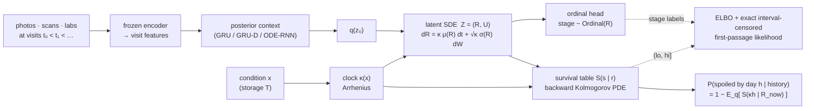

# ripen

[](https://github.com/nishadw/ripen/actions/workflows/tests.yml)


[](LICENSE)

**Neural first-passage processes: from a sequence of observations of a thing that will eventually spoil, fail or
decline, predict a calibrated distribution over *when* — exactly, from a learned stochastic model of its hidden state.**

An avocado is photographed daily until it spoils. A patient's labs are drawn at clinic visits until a disease
declares itself. An engine is inspected until it fails. In each case the event is seen only *between* two
visits (interval-censored) or not at all (right-censored), and the speed of decline depends on a condition —
storage temperature, dose, load — that we would like to extrapolate. `ripen` models the hidden state as a
**neural diffusion whose clock is a physical function of the condition** (Arrhenius for temperature), defines
the event as the **first passage** of a learned progression coordinate across a boundary, and derives the
event-time distribution **exactly** from the learned dynamics by solving the Kolmogorov equations on a grid —
the forward one to filter the state between visits, the backward one to forecast — with no path simulation
and no smoothed indicator. A latent-SDE ELBO variant handles multi-dimensional appearance latents. The resulting interval-censored likelihood is a proper
score, the clock is identifiable, and forecasting from any visit is a table look-up.

Seven other model families — the published classify-then-regress baseline, a direct regressor, discrete-time
survival heads, GRU / GRU-D / ODE-RNN encoders and a latent ODE — share one interface, one trainer and one
evaluation suite, so the comparison is fair. Course project for UMD CMSC 838B *Differentiable Programming*
(Fall 2026); built on the SDE solver and gradient benchmark of the earlier `neural-sde` repo ([Foundations](#foundations)).



## What is new

Per the venue scan in [`docs/venue_scan.md`](docs/venue_scan.md): deep survival models learn hazards from static or
sequential covariates; neural-SDE papers learn dynamics but never derive an event time from them; the one
first-hitting-time survival paper (DeepFHT, Phys Rev E 2026) uses closed-form Brownian motion with a network
only on its parameters; interval censoring reached ML venues in 2025–26 for tabular data only. `ripen` combines
a **learned nonlinear** latent diffusion, an **exact** first-passage likelihood under **interval censoring**, and a
**physical clock** that transfers across conditions — on image, microwave and clinical sequences, with
calibration reported. Claims and proofs-in-progress: [`docs/research_plan.md`](docs/research_plan.md),
[`docs/theory.md`](docs/theory.md). Primer: [`docs/background.md`](docs/background.md).

## Results

All cells **TBD** until the run exists (no GPU runs yet — [`docs/experiment_plan.md`](docs/experiment_plan.md)).
Test split, every unspoiled prefix of every test fruit. `nll` is the proper censored log score (model selection);
MAE is on uncensored instances; CRPS equals MAE for point predictions.

| Model | Inputs | Censoring | NLL ↓ | MAE ↓ | 80 % cov. | 80 % width | C-index ↑ | ECE ↓ |
|---|---|---|---|---|---|---|---|---|
| Xavier et al. 2024 (paper, by sample) | 1 photo + group | dropped | — | 1.04 | — | 0 | — | — |
| Hangud & Hangud 2026 (paper, fruit-weighted) | 1 photo + group | dropped | — | 1.126 | — | 0 | — | — |
| `stage_linear` (reimplementation) | 1 photo + group | dropped | — | TBD | — | 0 | TBD | — |
| `direct_reg` | 1 photo + T | dropped | — | TBD | — | 0 | TBD | — |
| `discrete_surv` | 1 photo + T | interval | TBD | TBD | TBD | TBD | TBD | TBD |
| `gru_gap` / `gru_d` / `ode_rnn` | photos so far + T | interval | TBD | TBD | TBD | TBD | TBD | TBD |
| `latent_ode` | photos so far + T | first passage | TBD | TBD | TBD | TBD | TBD | TBD |
| **`fpt_filter`** (exact grid filter) | photos so far + κ(T) | first passage, exact marginal likelihood | TBD | TBD | TBD | TBD | TBD | TBD |
| `latent_sde` (PDE-ELBO) | photos so far + κ(T) | first passage, exact given the posterior path | TBD | TBD | TBD | TBD | TBD | TBD |
| `latent_sde` (Monte Carlo likelihood) | photos so far + κ(T) | first passage, smoothed | TBD | TBD | TBD | TBD | TBD | TBD |

Second domains (PBC2 clinical, C-MAPSS degradation), the unseen-temperature transfer, the sparser-visit and
photo-count ablations and the multimodal A2SL runs land in [`results/summary.md`](results/summary.md).

**What runs today, on CPU, in CI:** the fake-fruit tests. Ripening is simulated from a known SDE at the
published rates (0.228 / 0.473 / 0.518 stages per day). The **exact grid filter** must recover the absolute
rates within 20 %, the noise within 40 % and the inverse-Gaussian spoilage CDF within 0.15; the latent-SDE ELBO
must recover the rate ratios within 15 % (its amortised posterior leaves a gap on the common factor —
`docs/theory.md` P3/P5) and with two temperatures the Arrhenius `E_a = 50 kJ/mol` within 15 % ([`tests/test_recovery.py`](tests/test_recovery.py)). The PDE solver matches the
inverse-Gaussian law to 0.001 ([`tests/test_fpt_pde.py`](tests/test_fpt_pde.py)).

## The model in five lines

```
dynamics   dR = κ(x) μ(R) dt + √κ(x) σ(R) dW        (progression R; physiological time s = κt)
observed   stage_k ~ Ordinal(R(t_k));  photo_k → soft stage q(x_k) → emission Σ_k q_k P(stage=k | R)
event      τ = inf{t : R(t) ≥ b}
inference  exact: density of R on a grid, p ← exp(κΔ Lᵀ) p between visits, p ← p·e_k at visits  (fpt_filter)
           or latent-SDE ELBO with posterior drift g_φ(Z, context, t) for appearance latents U      (latent_sde)
forecast   P(τ − t > h | history) = Σ_i p_i S(κh | r_i),  S from ∂_s S = μ ∂_r S + ½σ² ∂_rr S
```

The clock multiplies the generator, so in physiological time `s = κt` every item follows the same SDE and one
survival table serves every temperature and horizon. The likelihood of the censoring observation is the
product of inter-visit **bridge** no-crossing factors `Π_k [1 − exp(−2(b−r_k)(b−r_{k+1})/(σ²κΔ_k))]` times the
last-interval term `[S(κΔ_m | r_m) − …]` from the table (right-censored: no last factor) — exact under the
model by the Markov property (`docs/theory.md` P1; independently verified, `docs/verifier_report.md`). Gradients through the posterior solve are a config switch
(`backprop | checkpoint | adjoint`) via `nsde.sde_solve`; the Monte Carlo running-max estimator is kept as the
ablation (`event_likelihood: mc`).

## Reproduce

```bash
git clone https://github.com/nishadw/ripen && cd ripen
pip install -e ".[dev]"            # add ,features for the torchvision backbone
make test                          # ~4 min on CPU, includes the fake-fruit recovery tests
make smoke                         # every model: build, loss, gradient, predict on one batch
make synthetic-quick               # results/synthetic/recovery.png
bash run_umiacs.sh pipeline         # the whole paper on SLURM: setup -> data -> experiments -> summary
```

`run_umiacs.sh` needs `RIPEN_ACCOUNT / RIPEN_PARTITION / RIPEN_QOS` once (on UMIACS class accounts they default
to `class / class / default`; per-machine paths go in a gitignored `.ripen.env`); `--local` runs the same
sequence without SLURM. Every experiment is also one Hydra command
(`python scripts/train.py model=latent_sde data=avocado +experiment=logo splits.held_out=T10`). Splits are by
item, never by photo, and the split files are committed.

## Data

| Dataset | License | Items | Tracked over time | Condition | Labels | Role |
|---|---|---|---|---|---|---|
| 'Hass' avocado photos (Mendeley 10.17632/3xd9n945v8.1) | CC BY 4.0 | 478 fruit / 14,710 photos | daily, two sides | 10 °C, 20 °C, ambient | 5-stage index | labelled benchmark |
| A2SL / Stevens microwave avocados (Wu et al., IEEE J. Microwaves 2026) | provided | 15 fruit, 266 scan grids + photos | every other day | ambient | day-determined 5 classes | multimodal case study |
| PBC2 (Mayo trial) | open | 312 patients | irregular visits over years | drug arm | death / transplant | second domain |
| NASA C-MAPSS | open | 100–260 engines / subset | inspections every ~10 cycles | subset | failure cycle | second domain |
| Synthetic fake fruit | — | any | configurable | rates / temps | exact | unit tests |

Details: [`docs/dataset_survey.md`](docs/dataset_survey.md), [`docs/data_a2sl.md`](docs/data_a2sl.md),
[`docs/data_second_domain.md`](docs/data_second_domain.md). Raw data never enters git; manifests and split files do.

## Use it on your own data

Any longitudinal dataset with an absorbing event fits the `Item` schema: visits `(t, features, optional stage)`
and an interval `(spoil_lo, spoil_hi]` (`inf` when right-censored). `scripts/export_manifest.py` shows the CSV;
`ripen.models.fpt_pde` (the survival solver and the Markov-interval likelihood) and `ripen.models.clock` work
with any encoder that produces a scalar progression latent.

## Repository layout

```
src/ripen/
  data/        schema, synthetic simulator, loaders (avocado, a2sl, pbc2, cmapss, stevens stub), splits, features
  models/      heads, clocks, encoders, baselines, sequence models, latent ODE/SDE, fpt (MC) and fpt_pde (exact)
  train/       one trainer for every model
  eval/        proper and conventional metrics, prediction instances, plots
src/nsde/      SDE solve with a gradient-method switch; Black-Scholes / Heston pricers (foundations)
configs/       Hydra: data/, model/, train/, experiment/
scripts/       train, evaluate, make_splits, extract_features, ingest_a2sl, synthetic_recovery, smoke_all, summarize
run_umiacs.sh  the one file: setup, data, every experiment with SLURM dependencies, summary
slurm/         per-experiment job scripts (older, still valid)
tests/         CPU tests, run in CI
docs/          background, research plan, theory, literature review, venue scan, dataset notes, experiment plan
```

## Foundations

The SDE machinery was built first and benchmarked on two problems that are still here.

**How should you differentiate an SDE solve?** Backprop through the solver is exact and its memory grows
linearly with steps (10.3 MB at 512); recursive checkpointing is exact at about 1 MB and within 1.5× the
speed; the stochastic adjoint (Li et al. 2020) is constant in steps but with a large constant (~154 MB here),
64× slower and approximate — its error falls like 1/steps. Checkpointing is `ripen`'s default.


**Calibrating a neural local-volatility SDE** to a Heston implied-vol smile by differentiating a Monte Carlo
pricer end to end: 0.31 vol-point RMSE on quoted strikes, 0.26 on held-out strikes, vs 4.2 for the best flat
Black-Scholes vol (`experiments/local_vol_calibration.py`).


A 52-second demo of both, rendered from real runs: [`assets/demo.mp4`](assets/demo.mp4).

## Lecture

*Backprop Through Continuous Time: Neural SDEs — Modeling, Gradients, and Training*, a graduate lecture for
CMSC 838B built around the avocado shelf-life problem — [`lecture/`](lecture/).

## References

Verified citations with DOIs / arXiv IDs: [`docs/literature_review.md`](docs/literature_review.md) and
[`docs/venue_scan.md`](docs/venue_scan.md). The ones the code implements directly:

- Li, Wong, Chen, Duvenaud. Scalable Gradients for Stochastic Differential Equations. AISTATS 2020. arXiv:2001.01328.
- Kidger, Foster, Li, Lyons. Efficient and Accurate Gradients for Neural SDEs. NeurIPS 2021. arXiv:2105.13493.
- Rubanova, Chen, Duvenaud. Latent ODEs for Irregularly-Sampled Time Series. NeurIPS 2019. arXiv:1907.03907.
- Che et al. Recurrent Neural Networks for Multivariate Time Series with Missing Values. 2016. arXiv:1606.01865.
- Rindt, Hu, Steinsaltz, Sejdinovic. Survival regression with proper scoring rules and monotonic neural networks. AISTATS 2022. arXiv:2103.14755.
- Yanagisawa, Akiyama. A Strictly Proper Scoring Rule and a Calibration Metric for Interval-Censored Data Analysis. ICML 2026.
- Xavier, Rodrigues, Silva. Shelf-Life Management and Ripening Assessment of 'Hass' Avocado Using Deep Learning Approaches. Foods 13(8):1150, 2024. doi:10.3390/foods13081150.
- Wu, Choffin, Kong, Lee, Sun, Jeong. Noninvasive Microwave Imaging and Machine Learning to Assess Ripeness of Avocados. IEEE J. Microwaves 6(1), 2026. doi:10.1109/JMW.2025.3636171.
- Van Boekel. Kinetic Modeling of Food Quality: A Critical Review. Compr Rev Food Sci Food Saf, 2008. doi:10.1111/j.1541-4337.2007.00036.x.

Built on [JAX](https://github.com/jax-ml/jax), [Equinox](https://github.com/patrick-kidger/equinox), [Diffrax](https://github.com/patrick-kidger/diffrax), [Optax](https://github.com/google-deepmind/optax) and [Hydra](https://hydra.cc).
