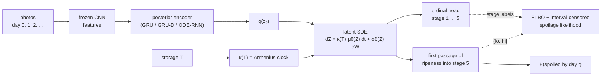

# ripen

[](https://github.com/nishadw/ripen/actions/workflows/tests.yml)


[](LICENSE)

**From photos of a piece of produce, predict a distribution over when it spoils — not a single days-left number.**

A fruit photographed daily is a time series with a hidden state. Spoilage is a first-passage event of that
state, observed only between visits (interval-censored) or not at all before the study ends (right-censored).
`ripen` models the hidden ripening state with a **latent neural SDE** whose clock runs at an **Arrhenius rate
set by storage temperature**, reads out a ripeness stage through an ordinal head, and reports
`P(spoiled by day t)` from Monte Carlo first-passage times. Seven other model families — the published
classify-then-regress baseline, a direct regressor, discrete-time survival heads, GRU / GRU-D / ODE-RNN
encoders, and a latent ODE — share one interface, one trainer and one evaluation suite so the comparison is fair.

Course project for UMD CMSC 838B *Differentiable Programming* (Fall 2026). Built on the SDE solver, gradient
benchmark and calibration code from the earlier `neural-sde` repo, which now lives in [`src/nsde`](src/nsde)
(see [Foundations](#foundations)).



## Why a distribution

The published model on this data (Xavier, Rodrigues & Silva, *Foods* 2024) classifies a photo into one of five
ripeness stages and applies a per-temperature linear rule, `days left = α_g (stage − 5)`; it is off by about a
day on average and says nothing about how sure it is. Two fruit that look the same today can spoil days apart.
A retailer acting on "good through Thursday, 1-in-5 chance it is bad by Tuesday" can price, move or discard
by risk. The follow-up that added storage temperature (Hangud & Hangud 2026) improved the point estimate but
threw away the 16 % of fruit that never spoiled inside the study. A survival likelihood keeps them.

## Results

All cells are **TBD** until the corresponding run exists (no GPU runs yet; see
[`docs/experiment_plan.md`](docs/experiment_plan.md)). Test split, every unspoiled prefix of every test fruit;
MAE in days on uncensored instances; CRPS equals MAE for point predictions, so all rows are comparable.

| Model | Inputs | Censoring | MAE ↓ | CRPS ↓ | 80 % cov. | 80 % width | C-index ↑ | ECE ↓ |
|---|---|---|---|---|---|---|---|---|
| Xavier et al. 2024 (paper, by sample) | 1 photo + group | dropped | 1.04 | 1.04 | — | 0 | — | — |
| Hangud & Hangud 2026 (paper, fruit-weighted) | 1 photo + group | dropped | 1.126 | 1.126 | — | 0 | — | — |
| `stage_linear` (reimplementation) | 1 photo + group | dropped | TBD | TBD | — | 0 | TBD | — |
| `direct_reg` | 1 photo + T | dropped | TBD | TBD | — | 0 | TBD | — |
| `discrete_surv` | 1 photo + T | interval | TBD | TBD | TBD | TBD | TBD | TBD |
| `gru_gap` | photos so far + T | interval | TBD | TBD | TBD | TBD | TBD | TBD |
| `gru_d` | photos so far + T | interval | TBD | TBD | TBD | TBD | TBD | TBD |
| `ode_rnn` | photos so far + T | interval | TBD | TBD | TBD | TBD | TBD | TBD |
| `latent_ode` | photos so far + T | first passage | TBD | TBD | TBD | TBD | TBD | TBD |
| **`latent_sde`** | photos so far + κ(T) | first passage | TBD | TBD | TBD | TBD | TBD | TBD |

Per-storage-group tables, the photos-vs-uncertainty curve, the every-2/3-days ablation and the
leave-one-group-out transfer land in [`results/summary.md`](results/summary.md) via `make summary`.

**What does run today (CPU, in CI):** the fake-fruit test. A label-only latent SDE with a linear drift,
constant diffusion and a per-group clock is fit to ripening simulated from a known SDE at the paper's rates
(0.228 / 0.473 / 0.518 stages per day) and must recover each rate within 25 %, the noise level within 50 %, and
the inverse-Gaussian spoilage CDF within 0.15 — it does, in under a minute ([`tests/test_recovery.py`](tests/test_recovery.py)).

## The model

Prior `dZ = κ(T) μθ(Z) dt + σθ(Z) dW`; posterior drift `κ(T) μθ(Z) + gφ(Z, ctx, t)` up to the last visible
photo, prior afterwards. Ripeness `r = w·Z + c`; stage `k` iff `θ_{k−1} < r ≤ θ_k` (cumulative-link ordinal
head); spoilage `τ = inf{t : r(Z_t) ≥ θ_4}`. Trained with the latent-SDE ELBO of Li et al. (2020):

```
log p(stages | Z)  +  log[ P(crossed by hi) − P(crossed by lo) ]  −  ½ ∫ |(f_post − f_prior)/σ|² dt  −  KL(q(z₀) ‖ p(z₀))
```

The crossing probability of a sampled path is a sigmoid of its running maximum's distance to the boundary
(the hard indicator has zero pathwise gradient), averaged over a few posterior paths. Right-censored fruit
contribute `log[1 − P(crossed by t_last)]`. At prediction time the prior is rolled forward from the posterior
state with 64 Brownian paths and the hard indicator gives the CDF. `κ(T)` is `exp(−Eₐ/R (1/T − 1/T_ref))` with a
learnable `Eₐ` initialised at 50 kJ/mol (the value implied by the paper's T10 vs T20 rates); a per-group clock is
the fallback, because in this data the ambient group ripened *faster* than the 20 °C group.

Gradients through the solve are a config switch — `method: backprop | checkpoint | adjoint` — using the
`nsde.sde_solve` wrapper benchmarked below.

## Reproduce

```bash
git clone https://github.com/nishadw/ripen && cd ripen
pip install -e ".[dev]"            # add ,features for the torchvision backbone
make test                          # 42 tests, ~2 min on CPU, includes the fake-fruit recovery
make smoke                         # every model: build, loss, gradient, predict on one batch
make synthetic-quick               # results/synthetic/recovery.png
# real data: download the Mendeley avocado set into data/avocado (CC BY 4.0), then
make splits features baselines sequence sde summary
```

Every experiment is one Hydra command (`python scripts/train.py model=latent_sde data=avocado +experiment=logo
splits.held_out=T10`) with a matching SLURM script in [`slurm/`](slurm/). Splits are by fruit, never by photo,
and the split files are committed.

## Data

| Dataset | License | Items | Tracked over time | Storage logged | Role |
|---|---|---|---|---|---|
| 'Hass' avocado ripening photos (Mendeley 10.17632/3xd9n945v8.1) | CC BY 4.0 | 478 fruit / 14,710 photos | daily, two sides | 10 °C, 20 °C, ambient | training |
| Stevens Institute produce set | — | unknown | ~every other day | unknown | pending; loader stub + manifest schema |
| TriModal Ripeness 6 (figshare 10.6084/m9.figshare.30783827) | CC BY 4.0 | 6 produce types | 3×/day until spoilage | no | multi-produce (structure unverified) |
| FreshLab-Tomato (IEEE DataPort 10.21227/wvqh-5c80) | unlisted / login | 12 tomatoes | 3×/day, 3 views | **T and RH** | κ(T) test |

Full survey with what each set can and cannot be used for: [`docs/dataset_survey.md`](docs/dataset_survey.md).

## Where this sits in the literature

Full review with verified DOIs / arXiv IDs and a gap table: [`docs/literature_review.md`](docs/literature_review.md).
In one paragraph: produce-imaging papers predict a stage or a point estimate from one photo and discard
censored items. Deep survival models (DeepSurv, DeepHit, Dynamic-DeepHit, SurvLatent ODE) model the hazard
from static or sequential covariates; DeepFHT (2025) is the nearest neighbour — event as the first hitting time
of a *closed-form* Brownian motion whose parameters a network reads off static covariates — and ICODEN (2026)
handles interval censoring with a neural hazard, again from static covariates. Food science has modelled
ripening rate as an Arrhenius function of temperature for decades, with hand-measured quality attributes.
Nobody has fit a learned nonlinear latent SDE's first passage to interval-censored image sequences with a
physical temperature clock. That combination, on the censored fruit both prior avocado papers dropped, is the claim.

## Repository layout

```
src/ripen/
  data/        schema (Item, Visit), synthetic simulator, avocado loader, Stevens stub, splits, feature cache
  models/      heads (ordinal, discrete survival), clocks, encoders, baselines, sequence models, latent ODE/SDE, FPT
  train/       one trainer for every model
  eval/        metrics (MAE, CRPS, coverage, C-index, reliability), prediction instances, plots
  pipeline.py  glue for the scripts
src/nsde/      SDE solve with a gradient-method switch; Black-Scholes / Heston pricers (foundations)
configs/       Hydra: data/, model/, train/, experiment/
scripts/       train, evaluate, make_splits, extract_features, synthetic_recovery, smoke_all, summarize
slurm/         one job script per experiment; account / partition / qos are CHANGE_ME in slurm/common.sh
tests/         42 CPU tests, run in CI
docs/          literature review, dataset survey, experiment plan, course proposal
experiments/   the nsde gradient benchmark and local-vol calibration
lecture/       CMSC 838B lecture: slides, speaker notes, reading guide, demo
```

## Foundations

The SDE machinery was built first, as a lecture companion, and benchmarked on two problems that are still here.

**How should you differentiate an SDE solve?** A 16-dim neural SDE, 32 paths, reversible Heun; gradient of a
terminal loss. Backprop through the solver is exact and its memory grows linearly with steps (10.3 MB at 512);
recursive checkpointing is exact at about 1 MB and within 1.5× the speed; the stochastic adjoint
(Li et al. 2020) is constant in steps but with a large constant (~154 MB here, growing with parameters and
noise channels), 64× slower, and approximate — its error falls like 1/steps because Diffrax solves the
continuous adjoint. Checkpointing is the practical choice and is `ripen`'s default.


**Calibrating a neural local-volatility SDE** to a Heston implied-vol smile by differentiating a Monte Carlo
pricer end to end: 0.31 vol-point RMSE on quoted strikes and 0.26 on held-out strikes, against 4.2 for the best
flat Black-Scholes vol. `experiments/local_vol_calibration.py`, ~12 min on CPU.


A 52-second silent demo of both, rendered from real runs: [`assets/demo.mp4`](assets/demo.mp4) (`assets/demo.gif`).

## Lecture

*Backprop Through Continuous Time: Neural SDEs — Modeling, Gradients, and Training*, a graduate lecture for
CMSC 838B built around the avocado shelf-life problem: neural ODEs and three ways to differentiate a solver,
the Itô toolkit, a latent SDE for ripening with an ordinal head and an Arrhenius prior, pathwise vs.
score-function gradients, the stochastic adjoint, the latent-SDE ELBO via Girsanov, diffusion models as
neural SDEs. [`lecture/`](lecture/) has the slides (PDF, PPTX with notes), reading guide and demo script.

## References

Verified citations with DOIs / arXiv IDs are in [`docs/literature_review.md`](docs/literature_review.md). The ones the code implements directly:

- Li, Wong, Chen, Duvenaud. Scalable Gradients for Stochastic Differential Equations. AISTATS 2020. arXiv:2001.01328.
- Kidger, Foster, Li, Lyons. Efficient and Accurate Gradients for Neural SDEs. NeurIPS 2021. arXiv:2105.13493.
- Rubanova, Chen, Duvenaud. Latent ODEs for Irregularly-Sampled Time Series. NeurIPS 2019. arXiv:1907.03907.
- Che, Purushotham, Cho, Sontag, Liu. Recurrent Neural Networks for Multivariate Time Series with Missing Values. 2016. arXiv:1606.01865.
- Avati et al. Countdown Regression: Sharp and Calibrated Survival Predictions. 2018. arXiv:1806.08324.
- Xavier, Rodrigues, Silva. Shelf-Life Management and Ripening Assessment of 'Hass' Avocado Using Deep Learning Approaches. Foods 13(8):1150, 2024. doi:10.3390/foods13081150.
- Van Boekel. Kinetic Modeling of Food Quality: A Critical Review. Compr Rev Food Sci Food Saf, 2008. doi:10.1111/j.1541-4337.2007.00036.x.
- Gierjatowicz et al. Robust pricing and hedging via neural SDEs. J. Computational Finance, 2022. arXiv:2007.04154.

Built on [JAX](https://github.com/jax-ml/jax), [Equinox](https://github.com/patrick-kidger/equinox), [Diffrax](https://github.com/patrick-kidger/diffrax), [Optax](https://github.com/google-deepmind/optax) and [Hydra](https://hydra.cc).
