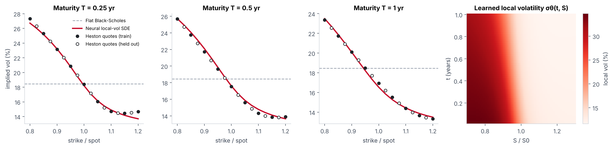
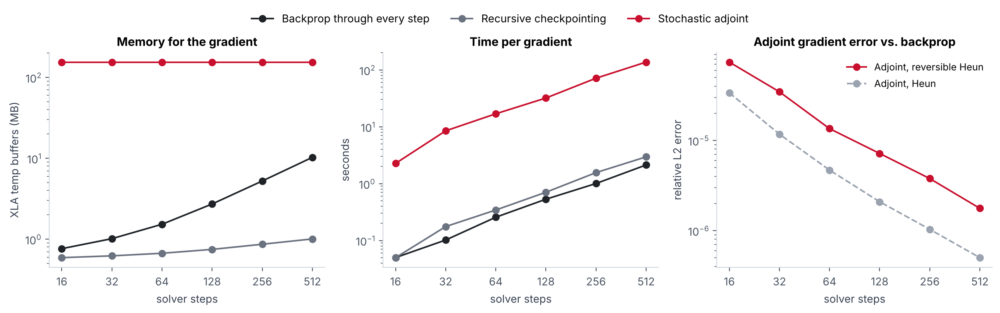

# Neural SDEs in JAX

[](https://github.com/nishadw/neural-sde/actions/workflows/tests.yml)


[](LICENSE)

**Backpropagating through stochastic differential equation solvers.** This repo:

1. calibrates a **neural local-volatility model** to a Heston implied-volatility smile by differentiating a Monte Carlo pricer end to end, and
2. benchmarks the **three ways to get that gradient** (backprop through the solver, recursive checkpointing, and the stochastic adjoint) on memory, speed, and accuracy.

It is the code companion to a lecture I gave in UMD's graduate course *Differentiable Programming* (CMSC 838B, Fall 2026). Slides, speaker notes, and the reading list are in [`lecture/`](lecture/).

## Demo (no code to run)


52 seconds, silent. Full-resolution video: [`assets/demo.mp4`](assets/demo.mp4). Every frame is rendered from a real run: the lecture demo script, `pytest`, a full 500-iteration calibration re-run that records the fitted smile every 5 steps, and the saved benchmark sweep. To rebuild it, run `experiments/demo_video/make.sh`.



## Results at a glance

| | Result |
|---|---|
| Neural local-vol fit to a Heston smile (3 maturities, 80–120% strikes) | **0.31 vol pts** RMSE on quoted strikes, **0.26** on held-out strikes |
| Same quotes, best flat Black-Scholes vol | 4.21 / 3.87 vol pts |
| Gradient memory at 512 solver steps | backprop **10.3 MB**, checkpointing **1.01 MB**, adjoint **154 MB** |
| Time per gradient at 512 steps | backprop 2.1 s, checkpointing 3.0 s, adjoint 137 s |
| Adjoint gradient error vs. backprop | 7.4e-05 at 16 steps → 1.8e-06 at 512 steps |

## 1. Calibrating a neural local-volatility SDE

**Setup.** "Market" quotes are European calls priced under Heston (κ = 1.5, θ = v₀ = 0.04, ξ = 0.6, ρ = −0.7) with a semi-analytic Fourier pricer, at maturities 0.25, 0.5 and 1 year and strikes from 80% to 120% of spot. The model is

$$ d\log S_t = \left(r - \tfrac12 \sigma_\theta(t, \log S_t)^2\right)dt + \sigma_\theta(t, \log S_t)\, dW_t $$

with $\sigma_\theta$ a 3-layer MLP. Prices are Monte Carlo averages over 8,192 Euler–Maruyama paths per step. The loss is vega-weighted squared price error, which approximates squared implied-vol error. Gradients flow **through the SDE solver and the Monte Carlo average** (pathwise derivatives), trained with Adam for 500 steps. Every other strike is held out of training.

**Result.** The neural SDE recovers the skew at all three maturities, including at strikes it never saw. Final evaluation uses 524,288 fresh paths.

| Implied-vol RMSE (vol pts) | Train strikes | Held-out strikes |
|---|---|---|
| Neural local-vol SDE | **0.31** | **0.26** |
| Flat Black-Scholes | 4.21 | 3.87 |

**Caveats.**
- A local-vol model can in principle match any arbitrage-free smile (Dupire), so the point here is the gradient pipeline, not the model class.
- The remaining error is mostly Monte Carlo noise: the training curve flattens at the noise floor.
- The worst-fit points are the short-dated far right wing, where the model under-prices the smile's upturn.

This follows the idea of Gierjatowicz et al., *Robust pricing and hedging via neural SDEs* (2020), at toy scale.

```bash
python experiments/local_vol_calibration.py          # ~12 min on a 2-core CPU
```

## 2. How should you differentiate an SDE solve?



A neural SDE with a 16-dim state and 32 sample paths, solved with reversible Heun; gradient of a terminal loss with respect to all network parameters. Memory is XLA's compiled temporary-buffer size.

| Method | What it does | Memory vs. steps | Gradient |
|---|---|---|---|
| **Backprop** | reverse-mode AD through every solver step | grows linearly | exact for the discretised solve |
| **Recursive checkpointing** | store a few states, recompute the rest | grows very slowly | exact |
| **Stochastic adjoint** | solve a backward SDE for the gradient (Li et al., 2020) | flat | approximate |

**Findings.**
- **The adjoint delivers constant memory, but with a large constant.** Its memory doesn't move with step count, but at this size it sits at ~154 MB, and it grows with parameter count and noise channels ([`adjoint_memory_scaling.py`](experiments/adjoint_memory_scaling.py)). Backprop needed 10.3 MB even at 512 steps.
- **What the adjoint's memory scales with:** going from 256 to 1,024 noise channels took it from 62 MB to 438 MB; going from 4k to 42k parameters took it from 95 MB to 389 MB (at 512 channels). Backprop used at most 3 MB in every one of those configurations at 64 steps.
- **The adjoint is slow:** about 64× slower than backprop per gradient here.
- **The adjoint gradient is approximate, even with reversible Heun.** Diffrax's `BacksolveAdjoint` solves the *continuous* adjoint ("optimise-then-discretise"), so its error is a discretisation error that shrinks as steps increase. The exact, constant-memory scheme of Kidger et al. (2021) pairs reversible Heun with a matching *discrete* adjoint; it is implemented in `torchsde`.
- **A reversible solver alone doesn't fix it.** Plain Heun's adjoint error was actually lower than reversible Heun's here. Both fall roughly like 1/steps.
- **Recursive checkpointing is the practical choice** at these scales: exact gradients, about 1 MB even at 512 steps, and within 1.5× of backprop's speed. That matches Diffrax's own recommendation.

```bash
python experiments/adjoint_tradeoffs.py              # full sweep, ~45 min on a 2-core CPU
python experiments/adjoint_tradeoffs.py --quick      # ~3 min
python experiments/adjoint_memory_scaling.py         # compile-only, ~2 min
```

## Using the package

```python
import jax, jax.numpy as jnp, equinox as eqx
from nsde import NeuralSDE, sde_solve

model = NeuralSDE(state_dim=4, width=32, depth=2, key=jax.random.PRNGKey(0))
params, static = eqx.partition(model, eqx.is_inexact_array)
drift = lambda t, y, p: eqx.combine(p, static).drift(t, y)
diffusion = lambda t, y, p: eqx.combine(p, static).diffusion(t, y)

def loss(p, key):
    y_T = sde_solve(drift, diffusion, jnp.ones(4), p, key,
                    n_steps=100, solver="reversible_heun",
                    method="checkpoint")      # or "backprop" / "adjoint"
    return jnp.sum(y_T ** 2)

grads = jax.grad(loss)(params, jax.random.PRNGKey(1))
```

Parameters must go through `args` (here `p`), not a closure: `BacksolveAdjoint` can only differentiate explicit inputs.

## Install and test

```bash
git clone https://github.com/nishadw/neural-sde && cd neural-sde
pip install -e ".[dev]"
pytest                                               # 8 tests, ~1 min
```

The tests check:
- the three gradient methods agree,
- checkpointing matches backprop exactly,
- Black-Scholes and implied-vol round-trip,
- Heston reduces to Black-Scholes as vol-of-vol → 0,
- negative spot-vol correlation produces a downside skew.

## Repository layout

```
src/nsde/
  models.py        NeuralSDE (drift + diagonal diffusion MLPs), LocalVolatility
  solve.py         sde_solve(): one switch for backprop / checkpoint / adjoint
  finance.py       Black-Scholes, vectorised implied vol, Heston (Fourier) pricer
experiments/
  local_vol_calibration.py    neural local-vol vs. Heston smile
  adjoint_tradeoffs.py        memory / time / error sweep over solver steps
  adjoint_memory_scaling.py   what the adjoint's memory grows with
  demo_video/                 renders assets/demo.mp4 and demo.gif from real runs
tests/             pytest suite (runs in CI)
results/           JSON outputs of the experiments
assets/            figures, demo video
lecture/           slides (.pptx, .pdf), reading guide (.docx), demo, build scripts
```

## The lecture

*Backprop Through Continuous Time: Neural SDEs: Modeling, Gradients, and Training*. A graduate student lecture with one running example throughout: predicting when an avocado goes bad from irregular daily photos (the public 'Hass' Avocado Ripening Photographic Dataset). It covers:

- **Continuous time:** neural ODEs, and three ways to differentiate a solver (backprop, checkpointing, adjoint).
- **Stochastic calculus:** the Itô toolkit, Itô vs. Stratonovich, and a neural SDE for ripening with an Arrhenius temperature prior.
- **Gradients through randomness:**
  - pathwise vs. score-function estimators;
  - why the gradient of a first-passage probability is zero pathwise;
  - the stochastic adjoint;
  - the benchmark in this repo.
- **Training and limits:**
  - the latent-SDE ELBO via Girsanov;
  - diffusion models as neural SDEs;
  - applications and open problems.
- **Backup slides:** derivations, a solver table, and Brownian bridges.

Results for the avocado example are placeholders until that experiment is built.

- [Slides (PDF)](lecture/neural_sde_lecture.pdf) · [PowerPoint with speaker notes](lecture/neural_sde_lecture.pptx)
- [Reading and prep guide](lecture/neural_sde_reading_guide.docx)
- [Live demo script](lecture/neural_sde_demo.py)

## References

- Chen, Rubanova, Bettencourt, Duvenaud. [Neural Ordinary Differential Equations](https://arxiv.org/abs/1806.07366). NeurIPS 2018.
- Li, Wong, Chen, Duvenaud. [Scalable Gradients for Stochastic Differential Equations](https://arxiv.org/abs/2001.01328). AISTATS 2020.
- Kidger, Foster, Li, Lyons. [Efficient and Accurate Gradients for Neural SDEs](https://arxiv.org/abs/2105.13493). NeurIPS 2021.
- Kidger. [On Neural Differential Equations](https://arxiv.org/abs/2202.02435). PhD thesis, 2022.
- Gierjatowicz, Sabate-Vidales, Šiška, Szpruch, Žurič. [Robust pricing and hedging via neural SDEs](https://arxiv.org/abs/2007.04154). J. Computational Finance, 2022.
- Song et al. [Score-Based Generative Modeling through SDEs](https://arxiv.org/abs/2011.13456). ICLR 2021.
- Heston. A closed-form solution for options with stochastic volatility. Review of Financial Studies, 1993.
- Albrecher, Mayer, Schoutens, Tistaert. The little Heston trap. Wilmott, 2007.

Built on [JAX](https://github.com/jax-ml/jax), [Equinox](https://github.com/patrick-kidger/equinox), and [Diffrax](https://github.com/patrick-kidger/diffrax).
