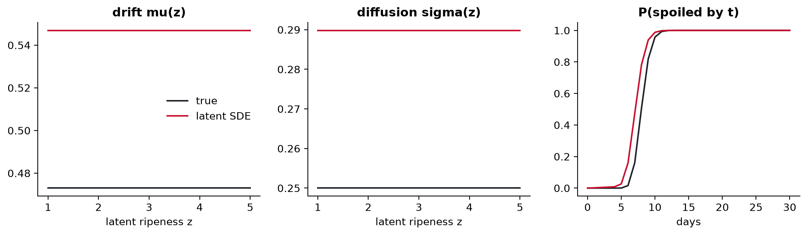
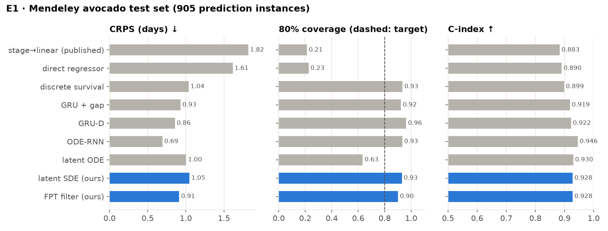
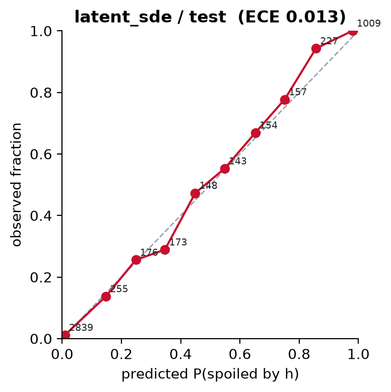
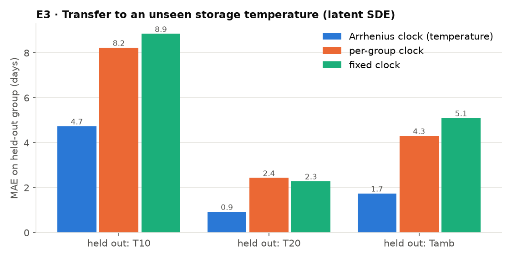
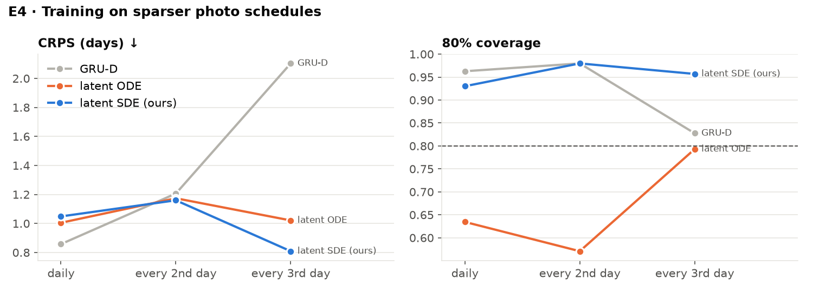
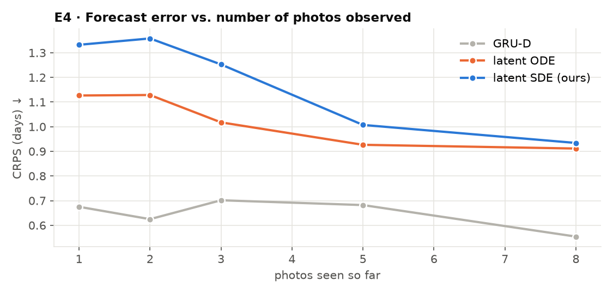
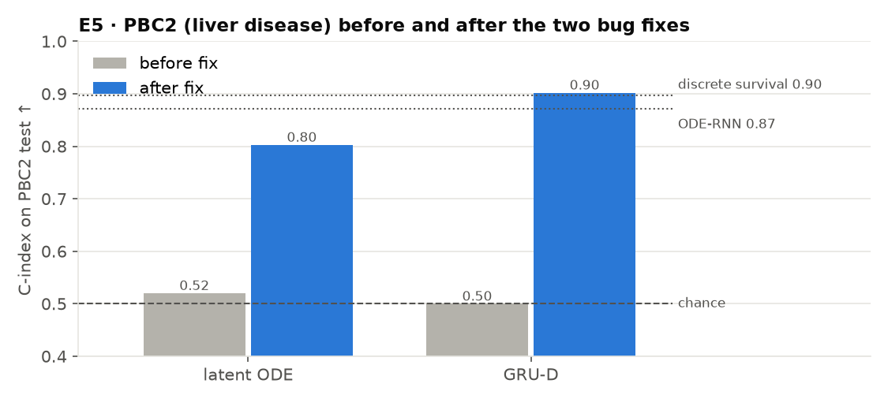

# ripen — Neural SDEs and ODEs for predicting *when* something spoils

**Progress report · 28 October 2026** · all numbers from `results/runs/*/metrics_test.json`, regenerated by
`python scripts/summarize.py && python scripts/make_report_figures.py`

> **Open in VS Code:** right-click this file → *Open Preview* (or `Ctrl+Shift+V` / `Cmd+Shift+V`).

---

## 1. The question

Given a sequence of observations of something that will eventually spoil, fail or die — daily photos of an
avocado, clinic labs of a liver patient, sensor readings of a jet engine — predict a **calibrated probability
distribution over the time remaining**, not just a single number.

Two things make this harder than ordinary regression:

* **Censoring.** We never see the exact moment of spoilage: only that the fruit was fine on day 6 and spoiled on
  day 7 (*interval-censored*), or that the study ended first (*right-censored*). The loss must use exactly
  that information.
* **Conditions change the speed.** A fruit at 10 °C ripens slower than at room temperature. A good model should
  *extrapolate* to a temperature it never saw in training.

## 2. The approach

The hidden state of each item is a latent vector $Z = (R, U)$. $R$ is a scalar "how far along" coordinate and
$U$ carries appearance. It evolves as a **neural stochastic differential equation**:

$$
dR = \kappa(T)\,\mu_\theta(R)\,dt + \sqrt{\kappa(T)}\,\sigma_\theta(R)\,dW_t
$$

* $\mu_\theta$, $\sigma_\theta$ are small neural networks (drift and noise).
* $\kappa(T)$ is a **physical clock**: an Arrhenius law $\kappa(T) = k_{\text{ref}}\exp\!\big(-\tfrac{E_a}{R_{\text{gas}}}(\tfrac1T - \tfrac1{T_{\text{ref}}})\big)$
  with a learned activation energy, so temperature only changes the *speed* of the same process.
* **Spoilage is a first-passage event:** the first time $R$ crosses a learned boundary $b$.
* The event-time distribution is computed **exactly** by solving the backward Kolmogorov PDE for the survival
  function on a grid — no Monte Carlo path simulation — so the interval-censored likelihood is exact.

The **latent ODE** is the same model with $\sigma \equiv 0$ (deterministic dynamics; uncertainty only from the
encoded initial state $q(z_0)$). Seven baselines share one trainer and one evaluation: the published
classify-then-regress method, a direct regressor, a discrete-time survival head, GRU / GRU-D / ODE-RNN sequence
models, and a Kalman-style first-passage filter ("FPT filter", our second model).

**Metrics** (test split, every prefix of every test item): **MAE** in days (months for PBC2) · **CRPS**, the
proper score for a whole predicted distribution (equals MAE for point predictors) · **80 % coverage**: how
often the true time falls inside the 80 % interval (should be ≈ 0.80) · **C-index**: ranking quality
(0.5 = chance, 1 = perfect).

## 3. Data

| Dataset | What | Size | Time unit |
|---|---|---|---|
| Mendeley avocado (CC BY 4.0) | daily photos, 3 storage temperatures (T10, T20, ambient) | 478 fruit, 14,710 photos | days |
| A2SL microwave (Univ. of Alabama) | microwave scans + photos, every other day — **added this week** | 15 fruit (4 tracked) | days |
| PBC2 (Mayo Clinic) | liver-disease labs at clinic visits → death | 312 patients | months |
| NASA C-MAPSS FD001 | turbofan sensor readings → failure | 100 engines | cycles / 10 |
| Synthetic fruit | generated from a known SDE, to check parameter recovery | 600 items | days |

All runs used the UMIACS Nexus class cluster (RTX A4000/A5000, one GPU per job, submitted with `sbatch`).

---

## 4. Results

### E0 · Sanity check: can the model recover a known process?

On synthetic data generated with known per-temperature rates and noise, the fitted model recovers the
**ordering and approximate size** of the rates (true 0.23 / 0.47 / 0.52 → fitted 0.28 / 0.55 / 0.59) and the
noise level (σ = 0.25 → 0.29). The rates are biased upward by ~15–20 %.



### E1 · Avocado: all models, standard split



| Model | CRPS ↓ | MAE ↓ | 80 % cov. | C-index ↑ |
|---|---|---|---|---|
| stage → linear (published baseline) | 1.82 | 1.82 | 0.21 | 0.883 |
| direct regressor | 1.61 | 1.61 | 0.23 | 0.890 |
| discrete survival | 1.04 | 1.49 | 0.93 | 0.899 |
| GRU-D | 0.86 | 1.23 | 0.96 | 0.922 |
| **ODE-RNN** | **0.69** | **0.94** | 0.93 | **0.946** |
| latent ODE | 1.00 | 1.35 | **0.63** | 0.930 |
| latent SDE (ours) | 1.05 | 1.53 | 0.93 | 0.928 |
| FPT filter (ours) | 0.91 | 1.23 | 0.90 | 0.928 |

**Takeaways.**
* Every distributional model beats the published classify-then-regress baseline (CRPS 1.82 → 0.69–1.05).
  Point predictors are badly over-confident (80 % coverage of 0.21–0.23).
* **SDE vs ODE:** they rank fruit equally well (C ≈ 0.93), but the deterministic latent ODE is
  **over-confident** — its 80 % intervals contain the truth only 63 % of the time, versus 93 % for the SDE. The
  noise term is what buys calibration.
* On this in-distribution split the strongest model is the plain ODE-RNN. The latent SDE's advantage is not
  in-distribution accuracy; it shows up under transfer (E3) and sparse sampling (E4).



### E2 · Exact PDE likelihood vs Monte Carlo

| Latent SDE likelihood | Avocado CRPS | Avocado 80 % cov. | Synthetic CRPS | Synthetic 80 % cov. |
|---|---|---|---|---|
| exact (backward Kolmogorov PDE) | 1.01 | 0.93 | 3.23 | 0.71 |
| Monte Carlo (smoothed crossing) | 0.90 | 0.84 | 1.41 | 0.87 |

The exact likelihood gives better-calibrated intervals on avocado, but **Monte Carlo is better on the synthetic
data**, where the exact method should win. This is an open problem (see §6).

### E3 · Transfer to a storage temperature never seen in training

Train on two temperature groups, test on the third. The only thing that changes between the three bars is the
clock $\kappa$.



| Held-out group | Arrhenius clock | per-group clock | fixed clock | GRU-D | direct regressor |
|---|---|---|---|---|---|
| T10 (cold) | **4.7** | 8.2 | 8.9 | 7.0 | 6.1 |
| T20 | **0.9** | 2.4 | 2.3 | 3.0 | 2.4 |
| ambient | **1.7** | 4.3 | 5.1 | 6.0 | 3.4 |

*(MAE in days on the held-out group.)* **This is the main result:** the physically-structured clock cuts the
transfer error by 1.7–2.9× against the better of the two ablated clocks and beats every black-box baseline in every held-out group.
Cold storage (T10) is still hard. It needs extrapolation *outside* the training temperature range, and
coverage there is only 0.26.

### E4 · Fewer photos

Models retrained with a photo every 2nd or 3rd day:



With a photo only every 3rd day the latent SDE has the best CRPS (0.81 vs 2.10 for GRU-D and 1.02 for the
latent ODE) and keeps its coverage at 0.96. The black-box GRU-D degrades sharply.



Error falls as more photos are seen. On the daily schedule GRU-D is better early on, which is consistent with E1.

### E5 · Other domains (PBC2 liver disease, C-MAPSS engines)

| Model | PBC2 MAE (months) ↓ | PBC2 C ↑ | C-MAPSS MAE ↓ | C-MAPSS C ↑ |
|---|---|---|---|---|
| direct regressor | 27.4 | 0.734 | **3.23** | 0.817 |
| discrete survival | 27.8 | 0.898 | 3.24 | **0.821** |
| GRU-D | 30.9 | **0.902** | 3.46 | 0.813 |
| ODE-RNN | 34.8 | 0.872 | 3.82 | 0.773 |
| **latent ODE** | **20.1** | 0.803 | 4.20 | 0.779 |
| latent SDE (ours) | 54.9 | 0.554 | 4.47 | 0.776 |
| FPT filter (ours) | 102.5 | 0.542 | 8.69 | 0.249 |

After the fixes in §5 the latent ODE has the lowest PBC2 error of any model. The latent SDE and the FPT filter
**do not yet work on PBC2**, and the FPT filter fails on C-MAPSS (see §6).



### E6 · A2SL microwave avocados (new data)

| Model | MAE (days) | CRPS | 80 % cov. | C-index |
|---|---|---|---|---|
| GRU-D | 5.56 | 3.79 | 0.89 | 0.500 |
| FPT filter | 1.44 | 1.04 | 0.89 | 0.844 |
| **latent SDE** | **1.00** | 1.20 | 0.89 | 0.781 |
| latent SDE + feature decoder | 3.00 | 1.97 | 0.78 | 0.422 |

Only 4 fruit are tracked to spoilage, so there are just **9 test instances**. Read this as a proof that the
pipeline runs on a second sensing modality, not as evidence for one model over another.

---

## 5. Bugs found and fixed this week

The first full pipeline run surfaced seven bugs. Each was diagnosed and fixed, and the affected runs were
repeated.

| # | Symptom | Cause | Fix |
|---|---|---|---|
| 1 | All 3 per-group-clock jobs (E3) crashed | Arrhenius-only settings were passed to the per-group clock | `make_clock` passes only `init_rate` to it |
| 2 | 4 E5 jobs crashed (`use_stages` not in config) | override of a key some model configs lack | `++model.use_stages=false` (add-or-override) |
| 3 | Generative A2SL run crashed | `decode_features` missing from the latent SDE config | declared with default `false` |
| 4 | A2SL features could not be built on Linux | photo HEIC→JPEG conversion was skipped | `pillow-heif` dependency; conversion on |
| 5 | **GRU-D on PBC2 produced NaN** | padded visits have $t = 0$, so their time gap is $-170$ months; $e^{+\ldots}$ overflows, and the masked-out `inf` still makes the gradient NaN | gap set to 0 on padded steps |
| 6 | **Latent ODE on PBC2: C-index 0.50** — same forecast for every patient | the posterior drift correction had **zero KL cost** when σ = 0, so it pushed $R$ to −21, far off the PDE grid (which starts at −1) | latent ODE follows the prior ODE from $z_0$, as designed |
| 7 | still C = 0.50 after fix 6 | with σ = 0 the Kolmogorov PDE is pure transport, so survival is a **step function** of $r$ and gives $q(z_0)$ no gradient | latent ODE uses the Monte Carlo likelihood |

How bugs 6–7 were found: a probe of the trained model's internals showed $R$ at forecast time spanning
$[-21.6, 0.1]$ on PBC2 versus $[2.2, 4.4]$ on avocado. Controlled reruns isolated the likelihood:

| Latent ODE on PBC2 | MAE (months) | C-index |
|---|---|---|
| original | 121.6 | 0.520 |
| + fix 6 (PDE likelihood) | 135.8 | 0.502 |
| + fix 6, KL weight 0.1 | 136.8 | 0.500 |
| + fix 6, **MC likelihood** (fix 7, final) | **20.1** | **0.803** |
| + fix 6, MC, KL weight 0.1 | 22.9 / 41.1 (two runs) | 0.875 / 0.866 |

Fixes 6–7 also changed the latent ODE on avocado and C-MAPSS slightly (C-MAPSS MAE 5.40 → 4.20). All
latent-ODE numbers in this report are from the fixed model. Every other model's numbers are unaffected: fix 5
changes nothing wherever the old computation was finite.

---

## 6. Limitations and next steps

1. **Latent SDE and FPT filter on PBC2.** Both still rank patients near chance (C ≈ 0.55). A lower KL weight
   helps the SDE (C 0.55 → 0.68) but doesn't fix it. The likely cause is the model's built-in time scale:
   drift caps, solver steps per unit and time normalisation are all tuned for *days*, while PBC2 runs ~170
   *months*. Next: make the time scale a per-dataset setting.
2. **FPT filter on C-MAPSS** ranks engines *worse than chance* (C = 0.25), which points to a sign or ordering bug.
3. **Exact vs Monte Carlo likelihood (E2).** The exact PDE likelihood should be at least as good as Monte Carlo
   but loses on synthetic data. Check the PDE grid resolution and the table range.
4. **Synthetic rate recovery** is biased upward by ~15–20 %.
5. **Single seed.** Each number is one training run. The two identical PBC2 runs in §5 (MAE 22.9 vs 41.1) show
   the spread between runs can be large on small datasets. Next: 3–5 seeds and error bars.
6. **A2SL** has only 4 tracked fruit, which is too few for model comparisons.

## 7. Reproduce

```bash
# on the UMIACS class cluster, from the repo root
bash run_umiacs.sh pipeline        # setup -> data -> every experiment -> summary (chained sbatch jobs)
bash run_umiacs.sh e1              # or one stage: synthetic, e1 ... e6, summary
python scripts/make_report_figures.py   # regenerate report/figures/
```

Full per-split tables: [`results/summary.md`](../results/summary.md). Method details:
[`docs/theory.md`](../docs/theory.md), [`docs/experiment_plan.md`](../docs/experiment_plan.md).
